# Gallery

``` r

library(trialfigs)
```

All figures are generated from **synthetic data** and are for
illustration only.

## Oncology

``` r

onc <- simulate_oncology(n_per_arm = 60)
```

``` r

plot_km(
  onc$adsl,
  time = "os_months",
  event = "os_event",
  arm = "arm",
  title = "Overall Survival"
)
```

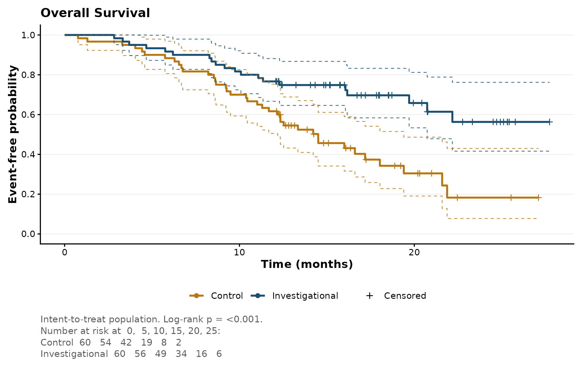

``` r

plot_waterfall(onc$adsl)
```

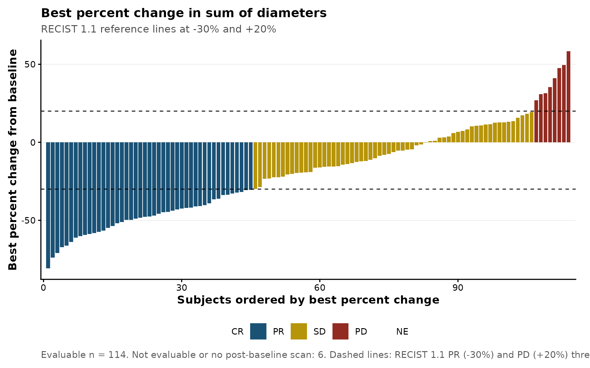

``` r

plot_swimmer(onc$adsl, max_n = 20)
```

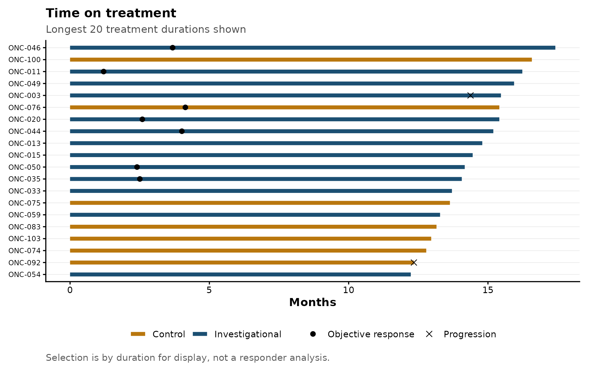

``` r

plot_spider(onc$adtr)
```

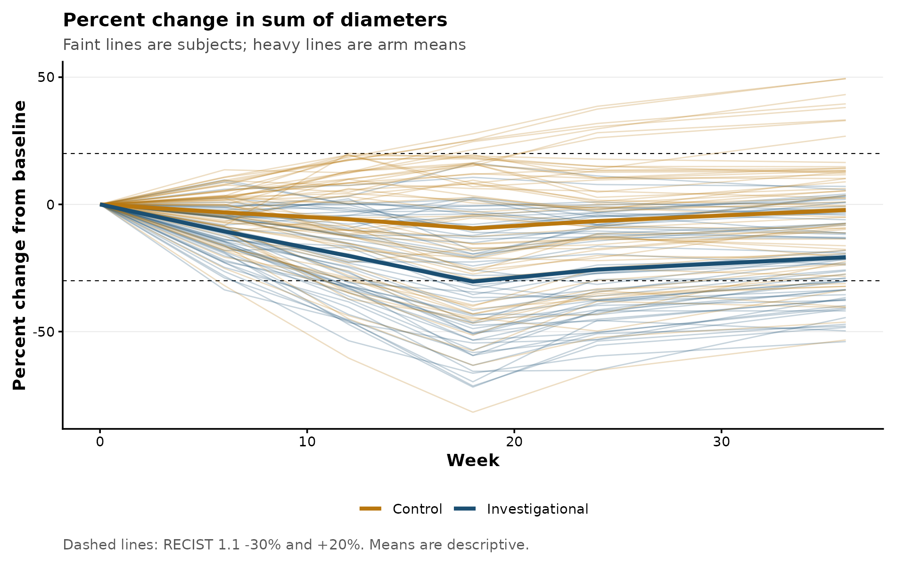

## Safety

``` r

saf <- simulate_safety(n_per_arm = 40)
```

``` r

plot_ae(saf$adae, denom = saf$adsl, reference = "Placebo")
```

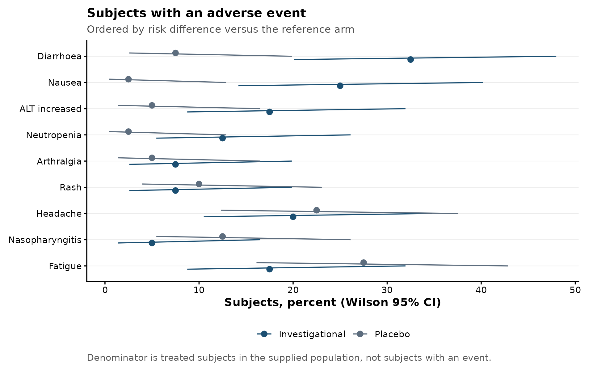

``` r

plot_edish(saf$adlb)
#> Warning: Use of `lab[[id]]` is discouraged.
#> ℹ Use `.data[[id]]` instead.
```

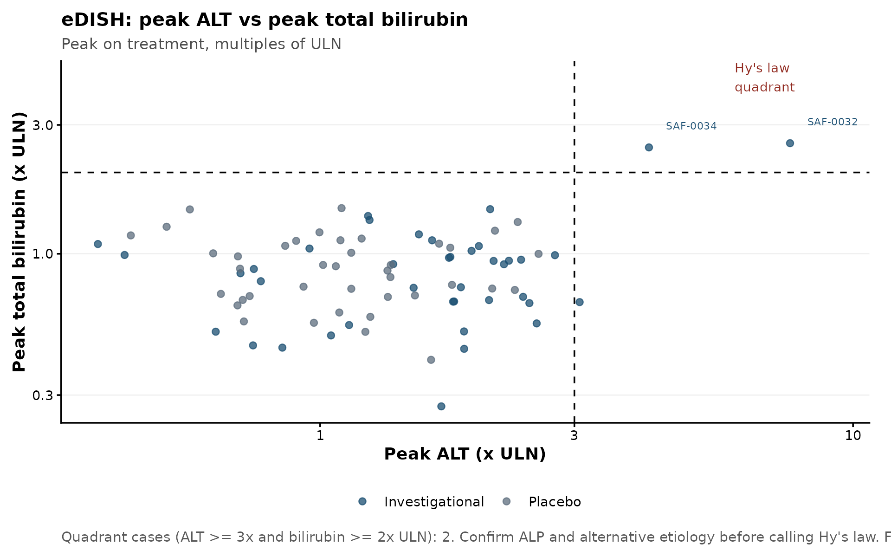

``` r

plot_exposure(saf$adsl)
```

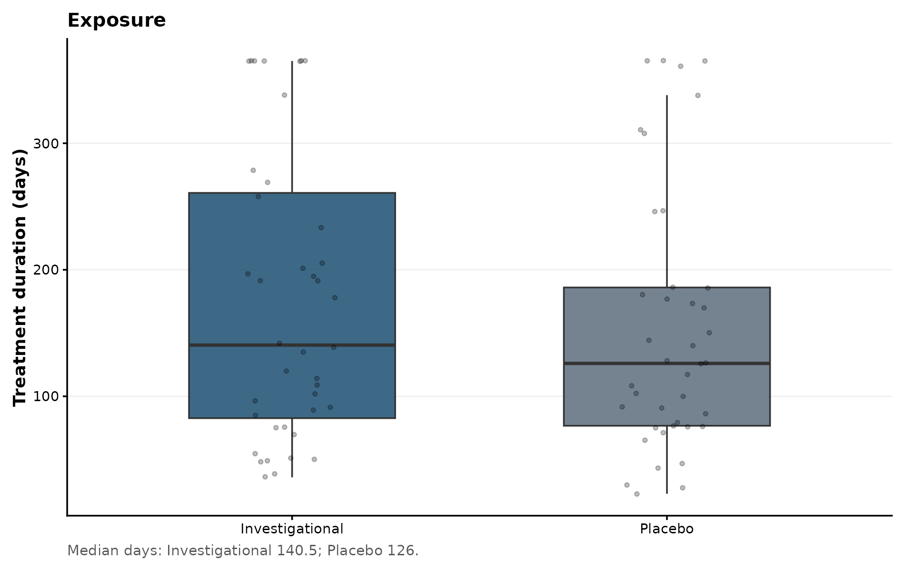

## Cardiovascular

``` r

cv <- simulate_cardiovascular(n_per_arm = 50)
```

``` r

plot_km(
  cv$adsl,
  time = "mace_months",
  event = "mace_event",
  arm = "arm",
  title = "Time to First MACE"
)
```

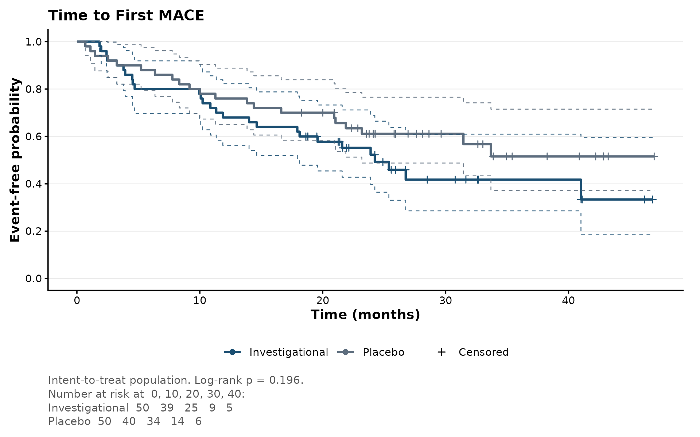

``` r

plot_change(
  cv$advs,
  title = "Mean Change in SBP",
  ylab = "Mean change in SBP (mmHg)"
)
```

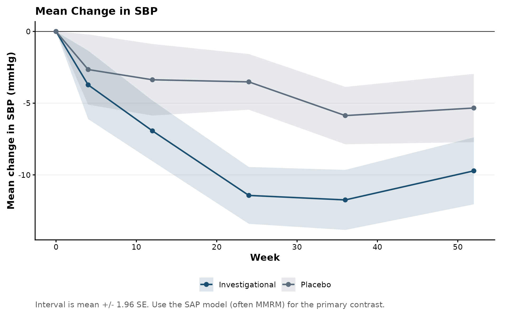

## Endocrinology

``` r

endo <- simulate_endocrinology(n_per_arm = 40)
```

``` r

plot_change(
  endo$adlb,
  title = "Mean Change in HbA1c",
  ylab = "Mean change in HbA1c (%)"
)
```

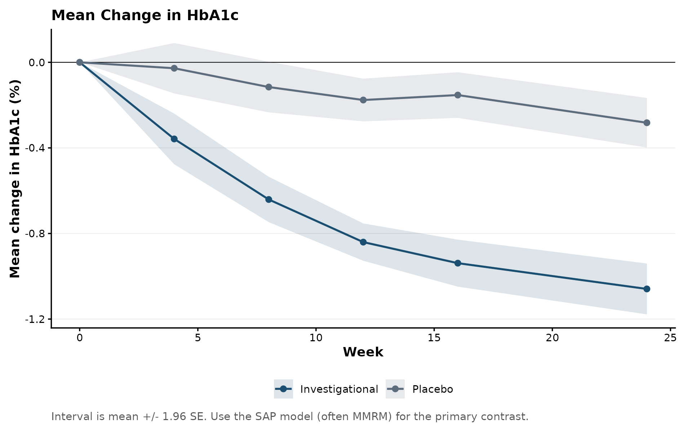

## Immunology

``` r

imm <- simulate_immunology(n_per_arm = 40)
```

``` r

# Note: immunology returns adeff (not adlb)
plot_change(
  imm$adeff,
  title = "Mean Change in DAS28",
  ylab = "Mean change in DAS28"
)
```

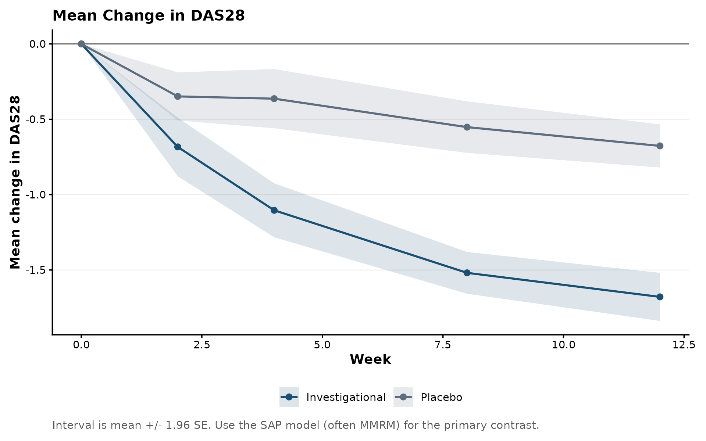

## Infectious Disease

``` r

inf <- simulate_infectious(n_per_arm = 40)
```

``` r

# Note: infectious disease uses "day" instead of "week"
plot_change(
  inf$adlb,
  visit = "day",
  title = "Mean Change in log10 Viral Load",
  xlab = "Day",
  ylab = "Mean change in log10 viral load"
)
```

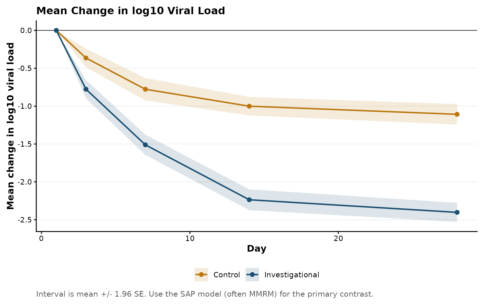

``` r

plot_km(
  inf$adsl,
  time = "clear_days",
  event = "clear_event",
  arm = "arm",
  title = "Time to Virologic Clearance",
  xlab = "Days"
)
```

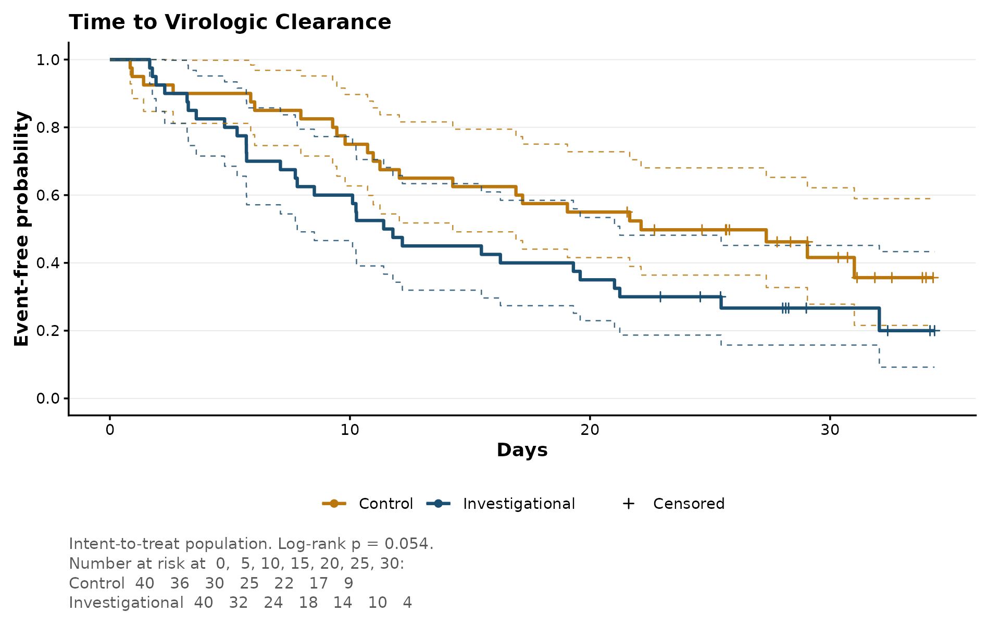

## Neuroscience

``` r

neuro <- simulate_neuroscience(n_per_arm = 40)
```

``` r

# Note: neuroscience returns adeff (not adlb)
plot_change(
  neuro$adeff,
  title = "Mean Change in MADRS",
  ylab = "Mean change in MADRS"
)
```

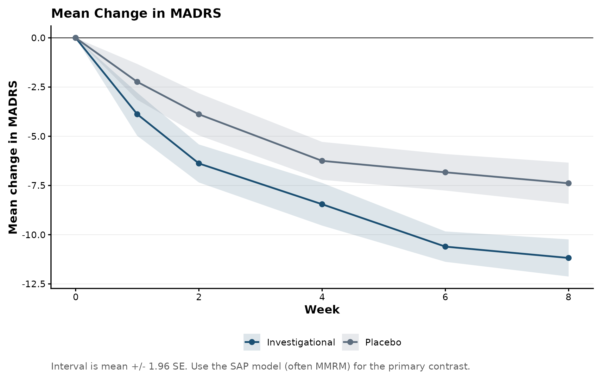
